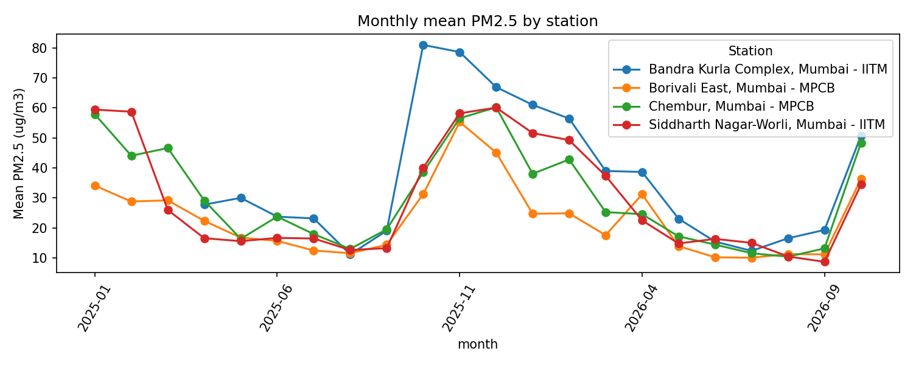

# CityPulse: Predict. Explain. Act.

Air-quality decision support for **Mumbai**, built for **HackAMatch 1.0 (Data Mavericks × NSDC), Data Science + AI Challenge**.

CityPulse uses free public data to help a municipal officer decide which monitoring stations to look at first, why, and what to do next.

> **Status:** educational prototype. It is **not** an official warning system and does not replace expert judgement.

---

## 1. Problem and intended user

- **Problem:** which monitoring stations in Mumbai need attention first, and what should an officer do about it?
- **Intended user:** a municipal or ward-level officer (BMC / MPCB role) who prioritises inspections and public advisories.
- **Decision supported:** where to send limited inspection capacity, and which advisory actions to consider.

## 2. What is in the app

The Streamlit app (`citypulse/app.py`) has **eight tabs** covering two datasets. They are separate on purpose and labelled as such in the app.

| Tabs | Dataset | What it does |
|---|---|---|
| 1 to 5 | 2021-2023 CPCB station AQI data, replayed historically | Risk prioritisation with adjustable policy weights and an inspection-capacity slider, discovery of patterns, weather and dispersion, forecast and calibration, data provenance and methods |
| 6 to 8 | Four-station PM2.5 snapshot, Jan 2025 to Oct 2026 | Action Centre (station-level suggested responses), Latest Data Check (estimate, range, data health), Knowledge Hub (action library and searchable FAQ) |

Tabs 1 to 5 are a **historical replay**, not a live alert. Tabs 6 to 8 are a **stored snapshot**, not a live feed. There is no automatic live update.

## 3. The core loop

| Step | What CityPulse does |
|---|---|
| **Discover** | Finds patterns in measured data: season, weekday, hour of day, station differences. |
| **Predict** | Next-day estimate compared against a persistence baseline ("tomorrow = today"). |
| **Explain** | Shows the evidence, an error range, data-quality warnings and a freshness label. |
| **Act** | Shows a risk tier and a suggested next step, with a responsible role. All actions are advisory. |

## 4. Key findings (four-station PM2.5 data, 2025-2026)

All numbers below come from `data/processed/evaluation_report.txt`, produced by the code in `src/`.

1. **Stations differ.** Mean daily PM2.5 was 32.5 µg/m³ at Bandra Kurla Complex, 30.1 at Chembur, 27.7 at Worli and 23.6 at Borivali East. The share of days above 60 µg/m³ ranged from 2.2% (Borivali East) to 14.4% (Bandra Kurla Complex).
2. **Strong seasonality.** Across the four stations the mean was about 15 µg/m³ in the monsoon (Jun-Sep), 25 in summer (Mar-May), 44 in post-monsoon October and 48 in winter (Nov-Feb). Only under two years of data are available, so this describes these stations, not a general rule.
3. **Weekday effect is small.** Weekday means ranged only from 27.6 to 29.6 µg/m³.

Charts: `data/processed/figures/monthly_pm25_by_station.png`, `pm25_by_hour.png`, `rolling_mae_by_month.png`.



Correlation between PM2.5 and other pollutants is reported in the evaluation report. It does not establish causes.

## 5. Method and validation

- **Split:** chronological. Every walk-forward fold trains only on dates earlier than its test period (asserted in code).
- **Operational baseline:** persistence. The estimate for tomorrow is today's daily mean PM2.5.
- **Model compared:** gradient boosting on lag features, evaluated on exactly the same rows as the baseline.
- **Result: persistence stayed the better method.** Over 1,391 pooled test rows, persistence had MAE 5.41 and RMSE 9.27 µg/m³, against 6.20 and 11.03 for the model. The model beat persistence in 1 of 17 months. A sensitivity check on the minimum valid hours per day (12, 18, 22) gave the same conclusion. For this reason persistence is the operational estimate and no accuracy claim beyond these measured numbers is made.
- **Uncertainty:** an empirical band from past day-to-day changes at similar PM2.5 levels (10th to 90th percentile). On 1,295 walk-forward predictions from 2025-07-01 the nominal 80% band had measured coverage of 81.9%. Coverage is weaker when PM2.5 is already high: only 47.6% on the 21 days at 90 µg/m³ or above.
- **High-pollution days (actual PM2.5 of 60 or more tomorrow):** persistence flagged days with precision 0.72 and recall 0.74. The model had precision 0.71 and recall 0.59.
- **Risk tier:** a rule-based heuristic on PM2.5 bands (Good, Satisfactory, Moderate, Poor, Very Poor, Severe). It is **not a probability** and it is **not the official overall AQI**.
- **Leakage control:** features use only information available at forecast time.

For tabs 1 to 5 (2021-2023 AQI replay), the app uses Ridge and gradient-boosting models, quantile intervals and a classifier for AQI above 200. On the 2023 holdout, persistence had the lowest point-forecast error, and the app states that interval undercoverage and false alerts call for caution. Full numbers: `citypulse/reports/EVALUATION.md` and `citypulse/reports/evaluation_metrics.json`.

Analysis notebook: [`CityPulse_AQI_Cleaning_EDA.ipynb`](CityPulse_AQI_Cleaning_EDA.ipynb).

## 6. Data

Full details: [`DATA_STATEMENT.md`](DATA_STATEMENT.md) and [`citypulse/DATA_SOURCES.md`](citypulse/DATA_SOURCES.md).

| Source | Publisher and terms | Used for |
|---|---|---|
| CPCB continuous air-quality archive (CAAQMS), https://cpcb.nic.in | Central Pollution Control Board and MPCB. Government open data (NDSAP). Accessed October 2026 | 2021-2023 hourly AQI: 597,912 deduplicated records across 36 station labels, 22,608 valid station-days (18-hour rule) |
| Open-Meteo historical weather archive, https://open-meteo.com | Open-Meteo GmbH (ERA5 reanalysis). CC BY 4.0 | Hourly weather for Mumbai coordinates (26,280 observations) |
| OpenStreetMap context via Overpass, https://www.openstreetmap.org | OpenStreetMap contributors. ODbL | Road, land-use and coastline context for 18 stations |
| Four-station PM2.5 hourly file, `data/citypulse_cleaned.csv` | CPCB-network stations operated by IITM (Bandra Kurla Complex, Worli) and MPCB (Borivali East, Chembur) | 2025-2026 snapshot in tabs 6 to 8: 53,187 hourly rows, 1 Jan 2025 to 21 Oct 2026 (Bandra Kurla Complex from 7 Apr 2025) |

OpenAQ was evaluated and rejected because it needs an API key, which would break reproducibility from a fresh clone.

All data is public and free to access. No paid APIs, datasets or subscriptions are needed. No synthetic data is used as evidence. No personal or sensitive data is used or published.

## 7. Run it locally

Requires Python 3.10 or newer.

```bash
git clone https://github.com/RatneshPathak/citypulse.git
cd citypulse

python -m venv venv
# Windows (Git Bash):
source venv/Scripts/activate
# Windows (cmd/PowerShell): venv\Scripts\activate
# macOS / Linux: source venv/bin/activate

pip install -r citypulse/requirements.txt
cd citypulse
streamlit run app.py
```

Open the local URL Streamlit prints (usually http://localhost:8501).

- No API keys, passwords or private data are needed.
- The app reads `citypulse/data/processed/` for tabs 1 to 5 and `data/processed/` at the repository root for tabs 6 to 8. All of it is committed.
- To rebuild the four-station outputs from `data/citypulse_cleaned.csv`: `python src/persistence_forecast.py` (from the repository root).
- To rebuild the 2021-2023 processed data: `python -m src.clean.clean_pipeline` (from inside `citypulse/`). See `citypulse/Makefile` for the other steps.

**Tests** (from the repository root): `pip install pytest` then `python -m pytest tests -q`. The suite has 11 tests covering the data schema, JSON parsing, missing and corrupt file handling, FAQ and action content, and a headless run of the app views.

## 8. Project structure

```
citypulse/                         # repository root
  README.md  DATA_STATEMENT.md  FUTURE_ROADMAP.md  INTEGRATION.md
  CityPulse_AQI_Cleaning_EDA.ipynb # cleaning and exploratory analysis
  data/                            # four-station data and outputs (data/processed/)
  src/                             # four-station pipeline and the new views
    persistence_forecast.py        # persistence estimate, bands, metrics
    action_centre.py  latest_check.py  knowledge_hub.py  knowledge_content.py
    app_standalone.py              # optional standalone entry for the three new views
  tests/test_ui.py
  citypulse/                       # main Streamlit app (2021-2023 replay plus all eight tabs)
    app.py  theme.py  components.py  charts.py  config.py  icons.py
    src/  data/  reports/  notebooks/
```

## 9. Limitations

- **Coverage:** only four stations in the 2025-2026 data, and under two years. Results may not generalise to the rest of Mumbai, and an unmonitored area should not be assumed clean.
- **Missing data:** hourly coverage ranges from 78.8% (Borivali East) to 95.6% (Chembur) over each station's period. Worli's SO2 is 100% missing. In the latest 30-day window Bandra Kurla Complex has only 7 days with a usable daily value (18 or more valid hours), and Borivali East has 15. The app shows these warnings.
- **Spikes:** isolated sensor spikes were kept in the data, not removed, so a spike may be real or a sensor fault.
- **Persistence cannot anticipate sudden changes.** The model did not beat it in this evaluation.
- **No ground-truth health outcomes,** so tiers are heuristics. PM2.5 tiers are not the official overall AQI.
- **Source attribution:** PM2.5 alone cannot identify a pollution source. Any site check suggested by the app needs on-site confirmation.
- **Freshness:** both parts are stored snapshots. Tabs 1 to 5 are a replay of past dates.

## 10. Responsible use

CityPulse is an educational prototype, not an emergency-warning system. Suggested actions and the roles named for them are illustrative prompts for expert review, and decisions rest with officials.

## 11. AI assistance and third-party components

- **AI assistance:** AI assistants (Claude, by Anthropic) were used for planning, code drafting, testing and documentation. The team is responsible for reviewing, running and explaining all code and results.
- **Open-source libraries:** pandas, NumPy, scikit-learn, statsmodels, Streamlit, Plotly, Folium and streamlit-folium, used under their respective licences.
- **Data attribution:** CPCB / MPCB open data; Open-Meteo (CC BY 4.0); OpenStreetMap contributors (ODbL).

## 12. Team

Ratnesh Pathak (Lead), Rishi Chaurasiya and Shreya Pandey.

## 13. Hackathon

HackAMatch 1.0, Data Mavericks × NSDC. Problem statement: *CityPulse*.
