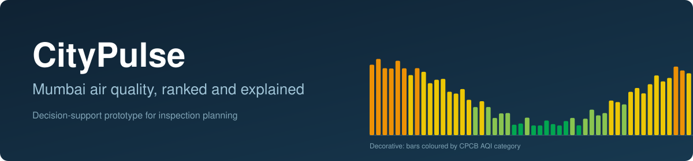
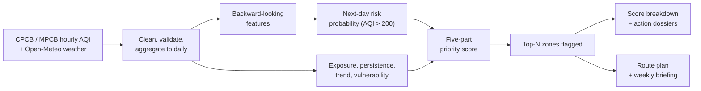
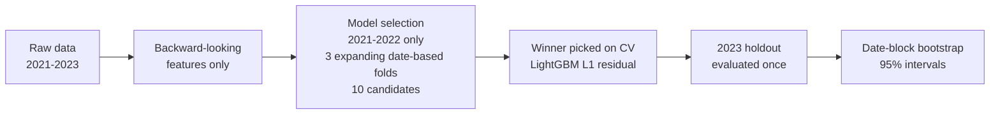
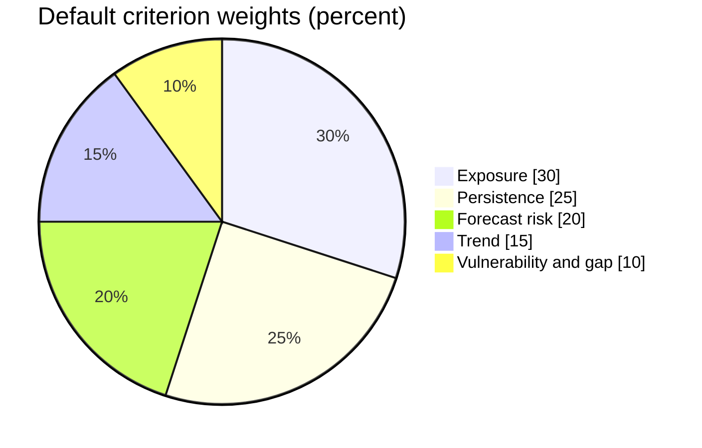

<p align="center">
  
</p>

<p align="center">
  
  
  
  
  
</p>

<p align="center">
  <a href="https://citypulseaweb.streamlit.app/"><b>Live demo</b></a> &nbsp;|&nbsp;
  <a href="#results-at-a-glance">Results</a> &nbsp;|&nbsp;
  <a href="#quick-start">Quick start</a> &nbsp;|&nbsp;
  <a href="reports/EVALUATION.md">Evaluation report</a> &nbsp;|&nbsp;
  <a href="reports/phase1b_cv.md">CV report</a> &nbsp;|&nbsp;
  <a href="DEPLOYMENT.md">Deployment</a> &nbsp;|&nbsp;
  <a href="DATA_SOURCES.md">Data sources</a>
</p>

CityPulse ranks Mumbai Metropolitan Region monitoring zones by inspection priority, using public CPCB air quality and Open-Meteo weather data. Every ranking comes with its reasons: a score breakdown for each zone and rule-based action dossiers.

> [!NOTE]
> **Status: prototype.** CityPulse supports municipal planning and prioritisation. It is not an official warning system and does not replace statutory monitoring by the CPCB or MPCB.

---

## At a glance

| Who it is for                                                                                                                         | Decision it supports                                                                 | Data                                                                                                                                         |
| :------------------------------------------------------------------------------------------------------------------------------------ | :----------------------------------------------------------------------------------- | :------------------------------------------------------------------------------------------------------------------------------------------- |
| Municipal environment and public health officers (BMC / MPCB) with limited inspection teams, road sweepers and dust-suppression units | Which zones should be prioritised this week, given a capacity budget of **N** zones? | **597,912** deduplicated hourly AQI records, **36** station labels (**30** active), **26,280** hourly weather observations (ERA5), 2021-2023 |

<details>
<summary><b>How a ranking is produced</b> (click to expand)</summary>



</details>

---

## Results at a glance

| What we measured                 | Result                                     | Reading                                                                                    |
| :------------------------------- | :----------------------------------------- | :----------------------------------------------------------------------------------------- |
| Next-day AQI error, 2023 holdout | MAE **18.83** vs **19.42** for persistence | 3.0% better, 95% CI [-1.07, -0.13]. Small but real. Beats persistence at 23 of 29 stations |
| Severe days (AQI > 200)          | Recall **0.870**, PR-AUC **0.812**         | Finds many more severe days than persistence (0.717), with more false alarms               |
| Weekly inspection backtest       | **+43.0%** hit-rate lift over random       | Does **not** beat simple lag-based baselines. See the backtest section                     |
| 80% prediction intervals         | **73.8%** empirical coverage               | Under-covers. Treat as rough ranges, not guarantees                                        |
| Tests                            | **40** unit and integration tests          | Run with `python -m unittest discover tests`                                               |

> [!IMPORTANT]
> Daily AQI is strongly autoregressive, so "yesterday's value" is a hard baseline. The gain over it is modest, and the 2023 holdout was viewed during earlier development. The more useful outputs are risk screening, explainable rankings and the decision tooling.

---

## Dashboard

Twelve tabs, grouped by what you are trying to do.

|                | Tab                               | What it gives you                                                                                                                                                                                               |
| :------------- | :-------------------------------- | :-------------------------------------------------------------------------------------------------------------------------------------------------------------------------------------------------------------- |
| **Decide**     | 1. Priority Ranking and Triage    | Five-part composite score, top-N capacity flags, ward map, rule-based action dossiers (mechanical sweeping, wet suppression, anti-smog guns) and a waterfall showing how each criterion built each zone's score |
|                | 2. What-If Policy Simulator       | Re-balance the weights and see rank stability from a 500-run Monte Carlo analysis, with perturbation heatmaps                                                                                                   |
|                | 3. Inspection Route Planner       | Nearest-neighbour tour (haversine distance) with stop-by-stop schedule, leg distances and cumulative travel                                                                                                     |
|                | 4. Briefing Export                | Printable weekly summary as HTML, with optional PDF                                                                                                                                                             |
| **Understand** | 5. Historical Patterns            | Diurnal traffic peaks, station differences, monsoon washout versus winter inversion                                                                                                                             |
|                | 6. Meteorological Coupling        | Wind speed and direction, sea-breeze ventilation, stagnation risk                                                                                                                                               |
|                | 9. Case Studies                   | Diwali episodes, winter trapping, coastal versus inland gradients                                                                                                                                               |
| **Trust**      | 7. Forecast Performance           | Parity plots, calibration curves, PR and ROC curves against persistence baselines                                                                                                                               |
|                | 8. Honest Validation and Backtest | Weekly inspection simulation and prediction-interval coverage                                                                                                                                                   |
|                | 12. Audit and Governance          | Data provenance, licences and stated limitations                                                                                                                                                                |
| **Share**      | 10. Citizen View                  | CPCB health guidance by category, sensitive-group advice, 7-day outlook, shareable cards                                                                                                                        |
|                | 11. Guided Walkthrough            | Eight-step presentation mode with metric counters and optional auto-advance                                                                                                                                     |

---

## What the data shows

| Finding                                                   | Number                                      |
| :-------------------------------------------------------- | :------------------------------------------ |
| Monsoon washout (Jun-Sep)                                 | mean station-day AQI **63.9**               |
| Winter inversion (Dec-Feb)                                | mean station-day AQI **185.0**              |
| Most polluted vs least polluted station (150+ valid days) | Mazgaon **153.0** vs Borivali East **88.6** |
| Wind speed and daily AQI                                  | r = **-0.25**                               |
| Days above AQI 200, calmest wind quintile                 | **16.2%** of station-days                   |
| Days above AQI 200, windiest wind quintile                | **5.8%** of station-days                    |

Season and location may confound the wind relationship. Full analysis: [`reports/eda_findings.md`](reports/eda_findings.md).

---

## How the models were validated



- **Splits are by date, not by row**, because several stations share each date.
- **Residual target:** the winner predicts the change from yesterday's AQI, so the forecast is yesterday's value plus a predicted change.
- **Cross-validation result:** OOF MAE 22.99, +3.87% skill vs persistence, paired date-block 95% CI `[-1.64, -0.23]`. Details in [`reports/phase1b_cv.md`](reports/phase1b_cv.md).

### Next-day AQI, 2023 holdout

| Model                                |    MAE    |   RMSE    |    R²     | Skill vs persistence | 95% CI (MAE difference) |
| :----------------------------------- | :-------: | :-------: | :-------: | :------------------: | :---------------------: |
| **LightGBM L1 residual (CV winner)** | **18.83** |   28.87   |   0.838   |      **+3.0%**       |   **[-1.07, -0.13]**    |
| Persistence (t-1)                    |   19.42   |   30.38   |   0.820   |         0.0%         |           n/a           |
| Ridge                                |   19.37   | **28.62** | **0.841** |        +0.2%         |     [-0.57, +0.49]      |
| Histogram gradient boosting          |   20.58   |   30.28   |   0.822   |        -6.0%         |     [+0.44, +1.89]      |
| Seasonal naive (t-7)                 |   34.57   |   50.01   |   0.513   |        -78.0%        |           n/a           |

```
MAE, lower is better
LightGBM L1 residual  ████████████████████████████                           18.83
Persistence           █████████████████████████████                          19.42
Ridge                 █████████████████████████████                          19.37
HistGB                ███████████████████████████████                        20.58
Seasonal naive        ████████████████████████████████████████████████████   34.57
```

_Reproduce:_ `python Evaluate.py --full`

> [!WARNING]
> **Disclosure.** The winner was chosen from 10 candidates using 2021-2022 data only, but the 2023 holdout was viewed during earlier development. The 3.0% gain is modest, and its interval stays close to zero.

### Severe days (AQI > 200), 2023 holdout

| Model                            | Precision |  Recall   |    F1     |  PR-AUC   |  ROC-AUC  |   Brier    |
| :------------------------------- | :-------: | :-------: | :-------: | :-------: | :-------: | :--------: |
| **Gradient boosting classifier** |   0.595   | **0.870** |   0.707   | **0.812** | **0.955** | **0.0758** |
| State persistence (t-1 > 200)    | **0.716** |   0.717   | **0.717** |    n/a    |    n/a    |    n/a     |
| Logistic regression              |   0.565   |   0.890   |   0.691   |   0.816   |   0.955   |   0.0844   |

The classifier catches more severe days but raises more false alarms. At the capacity-matched threshold (0.655), precision rises to 0.689 and recall is 0.774.

<p align="center">
  
</p>

_Reproduce:_ `python Evaluate.py --quick`

### 80% prediction intervals

Filled blocks are measured coverage; the lighter blocks show the shortfall to the 80% target.

```
Overall       ██████████████████████████████░░   73.8%
Monsoon       ███████████████████████████████░   77.1%
Summer        ██████████████████████████████░░   74.8%
Post-monsoon  █████████████████████████████░░░   72.7%
Winter        ████████████████████████████░░░░   69.5%
```

| Slice             | Nominal | Empirical |  Gap  | Mean width |
| :---------------- | :-----: | :-------: | :---: | :--------: |
| **Overall, 2023** |  80.0%  | **73.8%** | -6.2  |  55.6 AQI  |
| Monsoon washout   |  80.0%  |   77.1%   | -2.9  |  32.9 AQI  |
| Summer            |  80.0%  |   74.8%   | -5.2  |  56.9 AQI  |
| Post-monsoon      |  80.0%  |   72.7%   | -7.3  |  71.4 AQI  |
| Winter inversion  |  80.0%  |   69.5%   | -10.5 |  71.4 AQI  |

Coverage is weakest in winter. Treat the intervals as exploratory ranges, not calibrated bounds.

_Reproduce:_ `python Evaluate.py --quick`

### Weekly inspection backtest

Fifty-one weekly cycles in 2023, choosing the top 5 zones each week. A hit means an inspected zone had a daily AQI above 150 during the following 7 days.

```
Hit rate
Last-week-worst     ███████████████████████████████████████████  43.1%
Persistence-ranked  █████████████████████████████████████████    41.3%
CityPulse           █████████████████████████████████████████    40.6%
Uniform random      ████████████████████████████                 28.4%
```

| Strategy                     | Hit rate  | CityPulse lift |  Week-level 95% CI   |
| :--------------------------- | :-------: | :------------: | :------------------: |
| **CityPulse priority score** | **40.6%** |      n/a       |         n/a          |
| Uniform random               |   28.4%   |   **+43.0%**   | **[+30.4%, +60.7%]** |
| Persistence-ranked (lag-1)   |   41.3%   |     -1.8%      |    [-5.2%, +1.7%]    |
| Last-week-worst (7-day mean) |   43.1%   |     -5.9%      |   [-11.9%, -0.3%]    |

CityPulse clearly beats random selection. Against persistence the interval crosses zero, so the two are indistinguishable. Against last-week-worst the interval excludes zero, so CityPulse is slightly worse on raw hit rate. Its value lies in score attribution, route planning and context-specific dossiers, not in out-guessing lag-based rankings.

_Reproduce:_ `python Evaluate.py --quick`

---

## Priority score

A transparent weighted average of five normalised criteria, scaled 0-100:

```
score = (w_exp*S_exp + w_pers*S_pers + w_trend*S_trend + w_fore*S_fore + w_gap*S_gap) / sum(w)
```



| Criterion             | Weight | Measures                                                                    |
| :-------------------- | :----: | :-------------------------------------------------------------------------- |
| Exposure              |  0.30  | Recent 7-day mean AQI relative to national ambient standards                |
| Persistence           |  0.25  | Frequency of AQI > 150 in the past week                                     |
| Forecast risk         |  0.20  | Calibrated next-day probability of an AQI > 200 event                       |
| Trend                 |  0.15  | 7-day rate of worsening against a rolling baseline                          |
| Vulnerability and gap |  0.10  | Transit corridor siting, industrial micro-environments, monitoring sparsity |

---

## Quick start

Requires Python 3.10 or newer. No API keys needed.

```bash
git clone https://github.com/RishiBuilds/CityPulse.git
cd CityPulse
python -m venv venv
source venv/bin/activate          # Windows: venv\Scripts\activate
pip install -r requirements.txt   # dashboard
streamlit run app.py              # opens at http://localhost:8501
```

| I want to...                          | Run                                                                    |
| :------------------------------------ | :--------------------------------------------------------------------- |
| Use the dashboard                     | `pip install -r requirements.txt` then `streamlit run app.py`          |
| Run the tests (40)                    | `python -m unittest discover tests`                                    |
| Reproduce every reported result       | `pip install -r requirements-dev.txt` then `python Evaluate.py --full` |
| Do a fast live demo of the evaluation | `python Evaluate.py --quick`                                           |

> [!TIP]
> The deployed dashboard loads precomputed parquet files and does not import LightGBM, which is why `lightgbm` lives in `requirements-dev.txt`. Hosting steps for Streamlit Community Cloud and Hugging Face Spaces are in [DEPLOYMENT.md](DEPLOYMENT.md).

### Reproducing the evaluation

[`Evaluate.py`](Evaluate.py) runs everything end to end and prints a scorecard.

| Flag           | Effect                                                                        |
| :------------- | :---------------------------------------------------------------------------- |
| `--quick`      | Fewer bootstrap and Monte Carlo runs, 5 CV candidates. About 35 s             |
| `--full`       | 10 CV candidates, 2,000 bootstrap resamples, 500 Monte Carlo runs. About 47 s |
| `--skip-tests` | Skip the unit tests                                                           |
| `--seed N`     | Set the random seed (default 42)                                              |

Runtimes are approximate and machine-dependent. Outputs go to `reports/evaluate_summary.md`, `reports/evaluate_summary.json` and `reports/figures/`.

<details>
<summary><b>The ten stages</b></summary>

1. **Environment:** Python and library versions, seed, data integrity.
2. **Tests:** all 40 unit and integration tests.
3. **Leakage audit:** six checks on lags, rolling statistics, expanding means, split ordering, shuffling and duplicates.
4. **CV model selection:** expanding folds on 2021-2022 with date-block bootstrap intervals.
5. **Holdout:** MAE, RMSE, R² and station-level comparison on 2023.
6. **Classification:** AQI > 200 screening, calibration and capacity thresholding.
7. **Prediction intervals:** coverage and width overall and by season.
8. **Decision backtest:** 51 weekly top-5 cycles with week-level bootstrap intervals.
9. **Robustness:** Monte Carlo weight perturbation of plus or minus 30%.
10. **Summary:** scorecard, Markdown report and JSON.

</details>

<details>
<summary><b>Repository structure</b></summary>

```
citypulse/
├── app.py                  # 12-tab Streamlit dashboard
├── Evaluate.py             # End-to-end evaluation and reproducibility script
├── requirements.txt        # Runtime dependencies for the dashboard
├── requirements-dev.txt    # Training, evaluation and test dependencies (incl. LightGBM)
├── DATA_SOURCES.md         # Provenance, licences and schema
├── DEPLOYMENT.md           # Streamlit Cloud and Hugging Face Spaces
├── data/
│   ├── raw/                # CPCB telemetry and Open-Meteo weather
│   └── processed/          # Daily and hourly parquets, precomputed holdout predictions
├── src/
│   ├── data/               # Cleaning, 18-hour validity rule, hourly aggregation
│   ├── features/           # Backward-looking lag and rolling features
│   ├── models/             # Baselines, LightGBM CV pipeline, priority scoring
│   ├── decision/           # What-if simulator, route planner, backtest
│   └── demo/               # Guided walkthrough (Tab 11)
├── tests/                  # 40 unit and integration tests
└── reports/                # Generated reports, JSON and figures
```

</details>

<details>
<summary><b>Station counts explained</b></summary>

- **36** raw station labels appear in the telemetry archives.
- **30** stations pass our own quality threshold of at least 150 valid observation days across 2021-2023. This is an engineering threshold, not a statutory one.
- **29** of those stations reported in 2023. `Bandra` had 152 valid days in 2021 and none in 2022 or 2023. The 29 each had at least 30 valid days in 2023.

</details>

---

## Limitations

- **Strong autoregression.** Daily AQI depends heavily on the previous day, so large gains over persistence would likely need satellite AOD, dense local sensors and live traffic data.
- **Uneven coverage.** Stations cluster near major highways and industrial corridors, so unmonitored wards need proxy interpolation.
- **Point measurements.** A station reading does not describe a whole ward.
- **Exposure proxies only.** No clinical or health-outcome data is used.
- **Holdout reuse.** 2023 was viewed during earlier development.

> [!CAUTION]
> **Responsible use.** CityPulse is a screening and triage tool. It should guide physical inspections and supportive mitigation, and must not be the sole basis for punitive enforcement.

---

## Data and licences

| Data            | Source                                                      | Licence                                                              |
| :-------------- | :---------------------------------------------------------- | :------------------------------------------------------------------- |
| Air quality     | CPCB and MPCB CAAQMS archives                               | Government open data (NDSAP), see [DATA_SOURCES.md](DATA_SOURCES.md) |
| Weather         | [Open-Meteo](https://open-meteo.com) (ERA5 reanalysis)      | CC BY 4.0                                                            |
| Spatial context | [OpenStreetMap](https://www.openstreetmap.org) contributors | ODbL                                                                 |

---

<p align="center">
  Built by <b>Ratnesh</b>, <b>Rishi</b> and <b>Shreya</b> for HackAMatch 1.0<br>
  Released under the <a href="LICENSE">MIT License</a>
</p>
