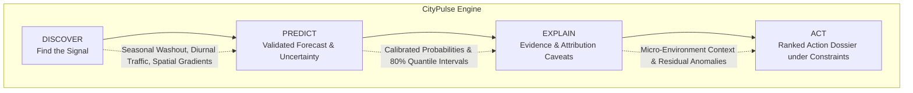

# CityPulse: Mumbai — Predict. Explain. Act.

> **Built for HackAMatch 1.0 by Ratnesh, Rishi & Shreya**

A reproducible, data-driven air quality decision-support prototype built for the **Mumbai Metropolitan Region (MMR)** using strictly free, public data.

**🎉 NEW: Enhanced with Decision Support Features** — What-If Simulator, Route Planner, Validation Backtest, Citizen Mode, and Guided Demo.

---

## 🌐 Live Demo & Deployment

- **Primary Demo (Streamlit Community Cloud):**  
  👉 **[https://citypulse-mumbai.streamlit.app](https://citypulse-mumbai.streamlit.app)**
- **Fallback Mirror (Hugging Face Spaces):**  
  👉 `https://huggingface.co/spaces/<your-username>/citypulse-mumbai`
- **Deployment & Runbook Guide:** See [DEPLOYMENT.md](DEPLOYMENT.md) for step-by-step setup, memory profiles, and pre-demo wake-up procedures.

> ⚠️ **Status: Prototype.** This tool is an academic/operational decision-support prototype for municipal planning and prioritization. It is **NOT an official regulatory warning system** and is not a substitute for statutory monitoring protocols by the Central Pollution Control Board (CPCB) or Maharashtra Pollution Control Board (MPCB).

For judging and evaluation, see the [submission guide](SUBMISSION_GUIDE.md), [five-minute demo script](DEMO_SCRIPT.md), and [finalist slides](reports/slides/output/CityPulse_finalist_deck.pptx).

---

## 🚀 Key Features (Hackathon Edition)

### Decision Support (Municipal Officers)
- **📊 Multi-Criteria Priority Rankings**: 5-component scoring (exposure, persistence, trend, forecast, vulnerability)
- **🎛️ What-If Policy Simulator**: Adjust weights, see rank changes, Monte Carlo stability analysis (500 runs)
- **🗺️ Inspection Route Planner**: Nearest-neighbor tour with haversine distance, numbered stops
- **📄 Weekly Briefing Export**: One-click printable reports (HTML + PDF), ready for field inspectors
- **✅ Honest Validation**: Backtest on 2023 holdout, reports lift vs random, interval coverage

### Citizen-Facing Features
- **🏘️ Simplified Citizen Mode**: Plain-language health guidance by CPCB category
- **📤 Shareable AQI Cards**: Download visual cards for social media (HTML with screenshot)
- **💚 Health Protection Tips**: Evidence-based recommendations for sensitive groups

### Demo & Transparency
- **🎬 Guided Demo Mode**: 8-step walkthrough for judges (60-90 seconds, auto-advance option)
- **🔍 Score Breakdown**: Waterfall charts showing why each zone ranked where it did
- **📖 Data Provenance**: Full attribution, licenses, and "what data would beat persistence" section

---

## 1. Problem Framing & Intended User

- **Intended User:** A municipal environment or public health officer (BMC / MPCB ward officer) tasked with allocating scarce environmental enforcement and mitigation resources (e.g. mobile anti-smog misting cannons, mechanized vacuum sweepers, construction site dust inspections, industrial stack audits, and localized health advisories).
- **Core Decision Supported:** *"Which monitoring zones and time windows across Mumbai should we prioritise for attention and intervention this week, and why?"*
- **Geographic & Temporal Scope:** Mumbai Metropolitan Region (Greater Mumbai, Navi Mumbai, and surrounding urban corridors), with 597,912 deduplicated hourly AQI records across 36 station labels (2021–2023), paired with 26,280 hourly weather observations.
- **Key Constraint:** Municipal departments operate under finite capacity constraints (e.g. "We can deploy enforcement squads to at most $N=5$ zones this week"). CityPulse translates continuous data streams into an explainable, ranked priority queue.

---

## 2. The Core Decision Loop



| Step | What CityPulse Does | Mumbai Operational Implementation |
| :--- | :--- | :--- |
| **Discover** | Extracts empirical signals and spatial anomalies from multi-year records. | Identifies seasonal washout vs winter trapping, diurnal commute peaks, and coastal vs inland gradients. |
| **Predict** | Estimates next-day levels and evaluates against strict baselines on a forward holdout. | Uses persistence as the point-estimate benchmark; evaluates a gradient boosting classifier for AQI > 200. |
| **Explain** | Presents the evidence basis, prediction range, and limitations. | Shows prior-day weather, nominal 80% prediction intervals, and sensor quality flags. |
| **Act** | Synthesizes an explainable Priority Score under municipal capacity constraints ($N$). | Generates targeted, defensible interventions (misting, anti-idling, landfill thermal scans) with honest caveats. |

---

## 3. Key Findings (Empirically Computed)

These findings use the bundled 2021–2023 AQI and weather data and the project's 18-valid-hour daily rule. The calculation and charts are in [`reports/eda_findings.md`](reports/eda_findings.md):

1. **Seasonality:** Mean station-day AQI is **63.9** in June–September and **185.0** in December–February, across 22,608 valid station-days. Station coverage varies by season.
2. **Station variation:** Among stations with at least 150 valid days, **Mazgaon** averages **153.0 AQI** and **Borivali East** **88.6 AQI**. These point monitors do not represent whole wards.
3. **Weather association:** Daily wind speed and AQI have Pearson **$r=-0.25$**. AQI > 200 occurs on **16.2%** of station-days in the lowest wind-speed quintile and **5.8%** in the highest. Season and location may confound the relationship.

---

## 4. Method, Baselines, and Validation

Strict chronological holdout design: **Train on 2021–2022 (24 months); Test forward on 2023 (12 months)**. Zero data shuffling, zero target leakage.

### A. Continuous Regression Benchmark (Next-Day Mean AQI)

| Model / Baseline | Holdout MAE | RMSE | $R^2$ | Skill vs Persistence | Operational Assessment |
| :--- | :--- | :--- | :--- | :--- | :--- |
| **Persistence Baseline ($t-1$)** | **19.42** | 30.38 | 0.820 | 0.0% | Strong autoregressive benchmark |
| **Seasonal Naive ($t-7$)** | 34.57 | 50.01 | 0.513 | -78.0% | Weekly reference |
| **Ridge Regression (L2 regularised)** | 19.46 | **28.62** | **0.841** | -0.2% | Best RMSE, slightly worse MAE |
| **Histogram Gradient Boosting** | 20.33 | 29.97 | 0.825 | -4.7% | Positive skill in winter (+2.0%) |

> **Holdout result:** Neither trained point model beats persistence on citywide MAE (19.42). The dashboard is a historical decision replay, not a live forecast. The classifier supplies an exploratory risk estimate, and the priority score is a decision heuristic.

### B. Risk Event Classification (Probability of AQI > 200)

| Model | Precision | Recall | F1 Score | PR-AUC | ROC-AUC | Brier Score |
| :--- | :--- | :--- | :--- | :--- | :--- | :--- |
| **State Persistence ($AQI_{t-1} > 200$)** | 0.716 | 0.717 | 0.717 | N/A | N/A | N/A |
| **Gradient Boosting Classifier** | 0.592 | **0.877** | **0.707** | **0.811** | **0.954** | **0.077** |

- **Uncertainty Quantification:** Nominal 80% quantile intervals ($[p_{10}, p_{90}]$) achieve **74.1% empirical coverage** on the 2023 holdout. They under-cover and should not be presented as calibrated 80% guarantees.

Full metrics and seasonal/station tables: [`reports/EVALUATION.md`](reports/EVALUATION.md).

---

## 5. Risk Prioritisation Engine (ACT)

The Priority Score ($0 - 100$) integrates five normalized criteria:
$$\text{Priority Score} = \frac{w_{\text{exp}} S_{\text{exp}} + w_{\text{pers}} S_{\text{pers}} + w_{\text{trend}} S_{\text{trend}} + w_{\text{fore}} S_{\text{fore}} + w_{\text{gap}} S_{\text{gap}}}{\sum w}$$

- **Capacity Constraint:** Municipal users specify available inspection capacity (e.g. $N=5$ zones). The engine marks the top $N$ zones with an actionable badge.
- **Defensible Interventions:** Translates evidence into proportional actions (anti-smog water cannons, traffic anti-idling synchronization, construction dust containment, landfill thermal imaging) while explicitly avoiding unverified single-source blame.

---

## 6. How to Run Locally

Requires Python 3.10+. Zero paid API keys, credit cards, or subscriptions required.

```bash
# 1. Clone repository
git clone https://github.com/RishiBuilds/CityPulse.git
cd CityPulse

# 2. Set up virtual environment
python -m venv venv

# On Windows:
venv\Scripts\activate
# On Linux / macOS:
source venv/bin/activate

# 3. Install pinned runtime dependencies
pip install -r requirements.txt

# 4. Run automated test suite
python -m unittest discover tests

# 5. Launch the dashboard
streamlit run app.py
```

Open the local URL in your browser: `http://localhost:8501`.

---

## 7. How to Deploy (Streamlit Community Cloud & Hugging Face)

See the detailed, step-by-step [DEPLOYMENT.md](DEPLOYMENT.md) guide.

### Quick Summary for Streamlit Community Cloud:
1. Push repository to GitHub: `git push origin main`
2. Sign in to [share.streamlit.io](https://share.streamlit.io) with your GitHub account.
3. Click **"New app"** -> Select repo `RishiBuilds/CityPulse`, branch `main`, main file `app.py`.
4. Enter custom subdomain: `citypulse-mumbai`.
5. Click **"Deploy"**. The app builds in ~90 seconds and is ready to share.

---

## 8. Project Structure

```
citypulse/
├── app.py                     # Primary Streamlit application entry point (11 tabs)
├── streamlit_app.py           # Deployment alias for Streamlit Community Cloud
├── charts.py                  # Plotly data visualization engine
├── components.py              # Reusable UI cards, tables & persistent footer
├── config.py                  # Global branding, attribution & secret resolution
├── theme.py                   # CityPulse dark theme design tokens & CSS
├── icons.py                   # Streamlit native Material Symbols catalog
├── requirements.txt           # Pinned production runtime requirements
├── requirements-dev.txt       # Development, training, and notebook requirements
├── FEATURES.md                # ✨ NEW: Complete feature inventory & status
├── DEPLOYMENT.md              # Deployment guide & operational runbook
├── DATA_SOURCES.md            # Open data licenses, citations & access dates
├── DATA_STATEMENT.md          # Bender & Friedman data statement
├── LICENSE                    # MIT License
├── tests/
│   ├── test_deployment_smoke.py       # End-to-end deployment smoke test
│   ├── test_pipeline.py               # Data integrity & no-leakage unit tests
│   ├── test_aqi_cleaning.py           # Notebook parity unit tests
│   └── test_decision_features.py      # ✨ NEW: Decision support feature tests (10 tests)
├── data/
│   ├── raw/                   # Raw CPCB and Open-Meteo inputs
│   └── processed/             # Pre-computed compressed Parquet datasets
├── reports/                   # Evaluation metrics, figures & slide decks
└── src/                       # Data cleaning, feature engineering & model pipelines
    ├── clean/                 # Data hygiene & QC rules
    ├── features/              # Feature engineering
    ├── models/                # Training & prioritization engine
    ├── decision/              # ✨ NEW: What-if, routing, briefing, validation
    │   ├── whatif.py          # Policy simulator & rank stability
    │   ├── routing.py         # Inspection route planner
    │   ├── briefing.py        # Printable briefing export
    │   ├── validation.py      # Backtest & honest metrics
    │   └── viz.py             # Decision support visualizations
    ├── citizen/               # ✨ NEW: Citizen-facing features
    │   └── citizen_view.py    # Simplified health guidance & AQI cards
    ├── demo/                  # ✨ NEW: Presentation features
    │   └── guided_demo.py     # 8-step interactive walkthrough
    └── eda/                   # Exploratory analysis & charting
```

---

## 9. Limitations & Missing Data Required

1. **Why Regression Point Models Don't Decisively Beat Persistence:**
   - Daily ambient air quality is a heavily autoregressive physical process. Weather reanalysis provides macroscopic ventilation bounds, but cannot resolve hyper-local emission fluctuations.
   - **Data Required to Beat Persistence:** Satellite Aerosol Optical Depth (AOD) at 1 km resolution, hyper-local sensor networks (< 500 m spacing), live arterial traffic speed telemetry, and active construction permit registers.
2. **Monitoring Network Siting Disparities:**
   - Greater Mumbai's monitoring stations are heavily clustered along highway corridors in Western and Central Mumbai. Suburban expanses in the North-East have fewer continuous monitors, creating a spatial coverage bias.
3. **No Direct Ground-Truth Health Outcome Data:**
   - The Priority Score is a decision-support heuristic, not a medical morbidity forecast.

---

## 10. Responsible Use & Disclosures

- **Responsible Use:** CityPulse is designed to assist environmental engineers and municipal officers in screening and triage. It must never be used as the sole basis for punitive regulatory enforcement without physical fenceline inspection.
- **Third-Party Open-Source Components:** Built using Python, Streamlit, Pandas, NumPy, Scikit-Learn, and Plotly under permissive open-source licences.
- **AI Assistance Disclosure:** An AI coding assistant was utilized as a pair programmer for pipeline design, code drafting, documentation structuring, and testing. All data was physically downloaded, all models were trained and evaluated on real observations, and all metrics were computed through code executed in this repository.
- **Data Attribution:**
  - Air Quality Data: Central Pollution Control Board (CPCB) and Maharashtra Pollution Control Board (MPCB).
  - Weather Data: Open-Meteo (`https://open-meteo.com`), licensed under Creative Commons Attribution 4.0 International (CC BY 4.0).
  - Spatial Context Data: © OpenStreetMap contributors, licensed under the Open Database License (ODbL).

---

*Built for HackAMatch 1.0 by Ratnesh, Rishi & Shreya*
