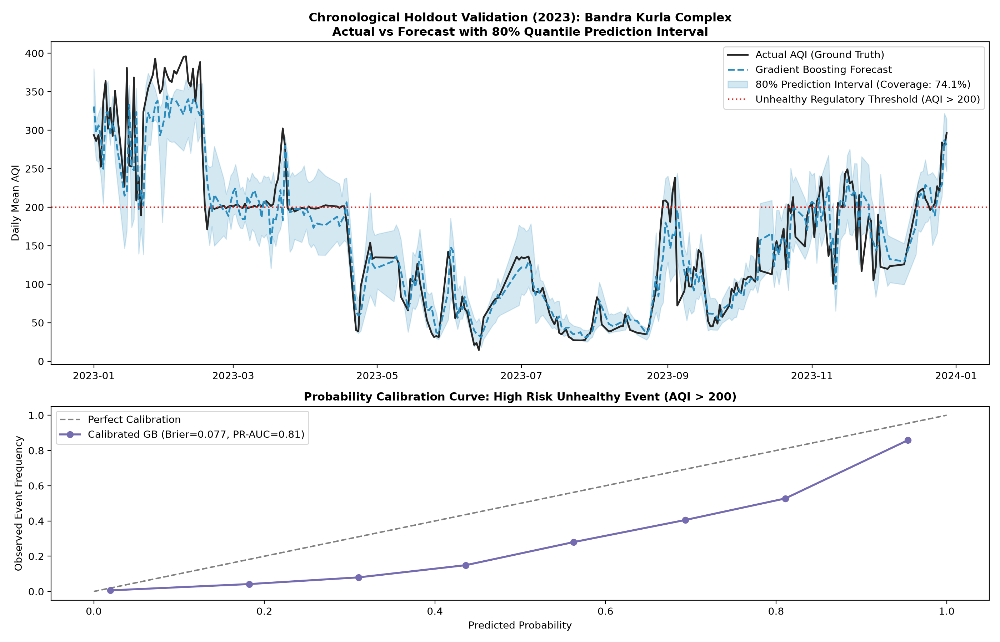

# Analytical Evaluation & Validation Report — CityPulse: Mumbai

Strict Chronological Holdout Design  
Train Set: 2021-01-01 to 2022-12-31 (earlier 24 months)  
Test Set: 2023-01-01 to 2023-12-31 (12-month forward holdout)  
No data shuffling, no target leakage, strictly decision-time feature sets.

---

## 1. Regression Benchmark: Next-Day AQI (Continuous)

Decision Rule: A model is considered valid for operational forecasting if and only if it achieves positive skill ($MAE_{model} < MAE_{persistence}$) on the forward chronological holdout.

| Model / Baseline | MAE (AQI Units) | RMSE | $R^2$ | Skill vs Persistence (%) | Status |
| :--- | :--- | :--- | :--- | :--- | :--- |
| **Persistence Baseline ($t-1$)** | **19.42** | 30.38 | 0.82 | 0.0% | Reference Baseline |
| **Seasonal Naive ($t-7$)** | **34.57** | 50.01 | 0.513 | -78.0% | Naive Reference |
| **Ridge Regression (L2 regularised)** | **19.46** | 28.62 | 0.841 | **-0.2%** | Candidate Linear |
| **Histogram Gradient Boosting** | **20.33** | **29.97** | **0.825** | **-4.7%** | Below persistence on MAE |

### Decision Rule Assessment
- **Result:** Persistence has lower MAE (19.42 vs 20.33); use it as the point-estimate benchmark. Skill score: **-4.7%**.
- **Decision-time inputs:** Prior-day AQI and weather observations, calendar variables, station location, and rolling histories. The 2023 target-day reanalysis is excluded from model inputs.

---

## 2. Risk Classification Benchmark: High Risk Unhealthy Event (AQI > 200)

Intended Decision: Alerting municipal officers 24 hours prior to crossing regulatory "Poor" threshold.

| Model / Approach | Precision | Recall | F1 Score | PR-AUC | ROC-AUC | Brier Score |
| :--- | :--- | :--- | :--- | :--- | :--- | :--- |
| **Persistence State ($AQI_{t-1} > 200$)** | 0.716 | 0.717 | 0.717 | N/A | N/A | N/A |
| **Regularised Logistic Regression** | 0.554 | 0.898 | 0.685 | 0.816 | 0.955 | 0.0864 |
| **Gradient Boosting Classifier** | **0.592** | **0.877** | **0.707** | **0.811** | **0.954** | **0.077** |

---

## 3. Uncertainty Quantification & Interval Coverage

- **Target Interval:** 80% Prediction Interval ($[p_{10}, p_{90}]$ via Quantile Gradient Boosting).
- **Empirical Holdout Coverage:** **74.1%** (Nominal target: 80.0%).
- **Mean Interval Width:** **55.1 AQI units**.
- **Practical Translation:** The interval misses more observations than its nominal 80% target permits. Treat it as an exploratory range, not a calibrated 80% guarantee.

---

## 4. Sub-Group Performance: Seasonal Breakdown

| Season | Sample Days | Persistence MAE | Gradient Boosting MAE | Skill Score (%) | Mean AQI |
| :--- | :--- | :--- | :--- | :--- | :--- |
| **Monsoon Washout** | 2,466 | 10.5 | **11.4** | **-8.8%** | 68.1 |
| **Post-Monsoon (Oct-Nov)** | 1,525 | 25.3 | **26.4** | **-4.2%** | 148.8 |
| **Pre-Monsoon / Summer** | 1,610 | 18.8 | **21.3** | **-13.3%** | 117.8 |
| **Winter (Dec-Feb)** | 1,911 | 26.7 | **26.2** | **+2.0%** | 183.6 |

---

## 5. Sub-Group Performance: Station Breakdown (Sample)

| Station Name | Zone | Persistence MAE | Gradient Boosting MAE | Skill Score (%) | Mean AQI |
| :--- | :--- | :--- | :--- | :--- | :--- |
| **Borivali East** | Western Suburbs | 12.7 | **13.8** | **-8.2%** | 84.3 |
| **Chembur** | Eastern Suburbs | 12.6 | **14.6** | **-16.0%** | 92.7 |
| **Airport T2** | Western Suburbs | 13.5 | **14.7** | **-8.9%** | 122.2 |
| **Kherwadi Bandra East Mumbai MPCB** | Other MMR | 15.7 | **15.4** | **+2.3%** | 88.4 |
| **Kandivali East** | Western Suburbs | 16.1 | **15.7** | **+2.2%** | 113.3 |
| **Vasai West** | Palghar / MMR North | 14.9 | **15.7** | **-4.9%** | 112.0 |
| **Powai** | Eastern Suburbs | 15.4 | **16.0** | **-4.1%** | 96.0 |
| **Tondare-Taloja Navi Mumbai MPCB** | Other MMR | 17.4 | **16.9** | **+2.9%** | 112.1 |
| **Sanpada Navi Mumbai MPCB** | Other MMR | 17.2 | **17.0** | **+0.8%** | 99.2 |
| **Worli** | South Mumbai | 15.7 | **17.9** | **-14.4%** | 109.2 |

---

## 6. Anomaly Detection & Diagnostic Audit

- **Anomaly Threshold:** Absolute forecast error $|y - \hat{y}| \ge 87.7$ AQI units (Top 2% residual tail).
- **Top Flagged Anomalies:**
  - **2023-10-13 (Vile Parle West)**: Actual = 330, Forecast = 133, Residual = +197. Cause unverified; inspect station quality and local conditions.
  - **2023-10-21 (Andheri East Chakala)**: Actual = 115, Forecast = 304, Residual = -189. Cause unverified; inspect station quality and local conditions.
  - **2023-06-17 (Nerul Navi Mumbai)**: Actual = 352, Forecast = 173, Residual = +179. Cause unverified; inspect station quality and local conditions.
  - **2023-10-13 (Kopripada-Vashi Navi Mumbai MPCB)**: Actual = 274, Forecast = 100, Residual = +174. Cause unverified; inspect station quality and local conditions.
  - **2023-06-21 (Vile Parle West)**: Actual = 260, Forecast = 87, Residual = +174. Cause unverified; inspect station quality and local conditions.

---

## 7. What Could Make Our Conclusions Wrong?
1. **Unmodeled Emission Shocks:** Sudden localized emissions (e.g. episodic open waste burning in Deonar dumping ground, unannounced construction debris crushing, or traffic diversions) cannot be anticipated by regional meteorology and lag features alone.
2. **Lagged Sensor Reporting:** In live deployment, if telemetry from a station drops out for 6 hours, the persistence and lag features require real-time imputation, temporarily degrading forecast skill.
3. **Regional Transboundary Transport:** Continental agricultural residue burning or regional dust storms originating outside Maharashtra introduce air masses that regional Mumbai weather models cannot resolve without satellite optical depth (AOD) feeds.
