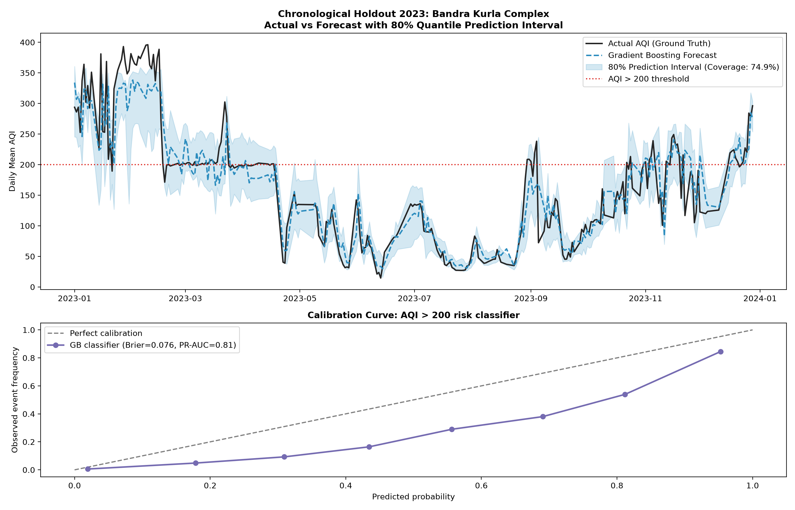
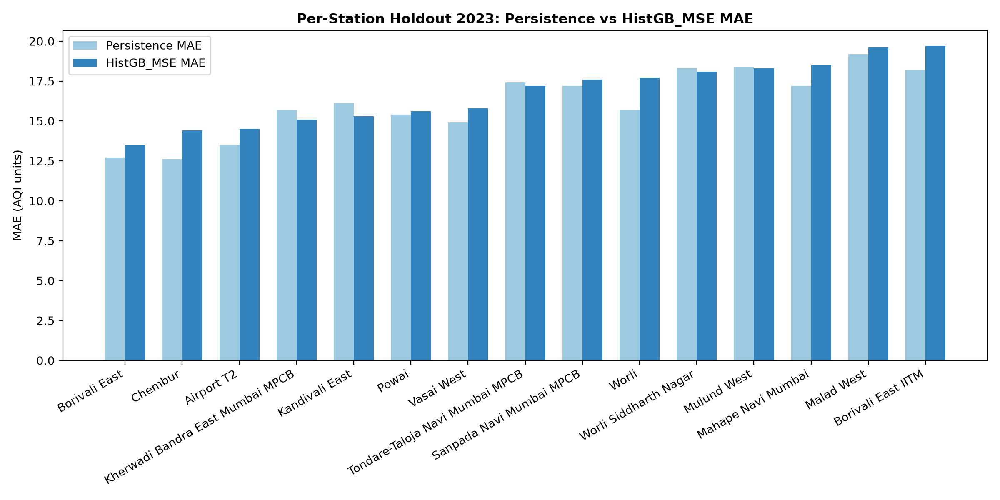

# Analytical Evaluation & Validation Report — CityPulse: Mumbai

## Phase 1b CV-only checkpoint

The [Phase 1b CV report](phase1b_cv.md) contains the preregistered ablation and ten candidate configurations, including five LightGBM variants. It reports pooled, per-fold, and per-season MAE and skill against persistence. Its 95% paired bootstrap CIs resample **dates**, keeping all stations on a sampled date together (2,000 replicates, seed 42). The CV-selected model is LightGBM L1 on the persistence residual. The Phase 1b 2023 holdout has **not** been run.

The Phase 1a results below are historical. The 2023 holdout was viewed during earlier development. The Phase 1a CIs below resampled rows and are superseded by the Phase 1b date-resampled CV CIs; they should not be used for a Phase 1b claim.

Strict Chronological Holdout Design  
Train Set: 2021-01-01 to 2022-12-31 (24 months)  
Test Set:  2023-01-01 to 2023-12-31 (12-month forward holdout, viewed in earlier development)  
No data shuffling, no target leakage, strictly decision-time feature sets.

Phase 1a feature additions (2026-10-23): lag_14, rolling_mean/std_14d, month,
aqi_delta_1d, aqi_delta_7d, station_expanding_mean_aqi (shift-1 expanding mean),
is_holi_window (Wikipedia Holi dates across multi-year period).

---

## 0. lag_2_aqi status

`lag_2_aqi` is confirmed present in `get_feature_columns()` and in the parquet
(verified 2026-10-23 before any other changes).

---

## 1. Model-selection CV (2021-2022 only)

Three expanding folds with **date boundaries** — splits are on the date column,
not the row index (the dataset is stacked multi-station).  Fold 1 trains on a
minimum of 12 months.  Features are backward-looking only (lags, prior-day
weather, expanding mean shifted by 1 day); no gap is needed for leakage
prevention, and none is claimed here.

Ridge alpha was selected by `RidgeCV` on the same three date-based folds
(`scoring=neg_mean_absolute_error`, log-scale grid 0.1–10 000).
Best alpha: **12.12**.

Bootstrap CI = paired 95% CI on (MAE_model − MAE_persistence), 2000 replicates,
fixed seed=42.  Negative CI → model better than persistence.

| Model | OOF MAE | OOF RMSE | OOF R² | Skill vs Persist | Bootstrap CI (MAE diff) | Per-fold MAEs |
| :--- | :--- | :--- | :--- | :--- | :--- | :--- |
| **Persistence** | 23.91 | 37.68 | 0.749 | +0.0% | +0.00 to +0.00 | 31.86, 16.36, 23.11 |
| **Ridge** | 23.22 | 35.46 | 0.777 | +2.9% | -1.02 to -0.34 | 30.08, 16.45, 22.76 |
| **HistGB_MSE** | 25.04 | 37.55 | 0.75 | -4.7% | +0.66 to +1.58 | 31.66, 20.06, 23.17 |

CV winner: **Ridge**

---

## 2. Regression Benchmark: Next-Day AQI — 2023 Holdout (evaluated once)

| Model / Baseline | MAE | RMSE | R² | Skill vs Persistence | Bootstrap 95% CI (MAE diff) |
| :--- | :--- | :--- | :--- | :--- | :--- |
| **Persistence (t-1)** | **19.42** | 30.38 | 0.82 | 0.0% | — |
| **Seasonal Naive (t-7)** | **34.57** | 50.01 | 0.513 | -78.0% | — |
| **Ridge (alpha=12.1)** | **19.58** | 28.65 | 0.84 | -0.8% | [-0.11, +0.43] |
| **HistGB_MSE** | **20.35** | 29.92 | 0.826 | -4.8% | [+0.60, +1.24] |

**Result:** Persistence has lower MAE (19.42 vs 20.35); dashboard uses historical replay rather than live forecast.  
Features used: 36 (was 27 before Phase 1a).

---

## 3. Risk Classification: AQI > 200 — 2023 Holdout

| Model | Precision | Recall | F1 | PR-AUC | ROC-AUC | Brier |
| :--- | :--- | :--- | :--- | :--- | :--- | :--- |
| **Persistence state** | 0.716 | 0.717 | 0.717 | N/A | N/A | N/A |
| **Logistic Regression** | 0.573 | 0.887 | 0.696 | 0.815 | 0.955 | 0.0835 |
| **GB Classifier** | **0.593** | **0.872** | **0.706** | **0.811** | **0.955** | **0.076** |

---

## 4. Uncertainty Quantification — 2023 Holdout

- **Target interval:** 80% prediction interval ([p10, p90] via quantile GB).
- **Empirical coverage:** **74.9%** (nominal: 80.0%).
- **Mean interval width:** **55.5 AQI units**.
- **Practical note:** Coverage is below the 80% nominal target; treat as an
  exploratory range, not a calibrated guarantee.

---

## 5. Seasonal Breakdown — 2023 Holdout

| Season | N days | Persistence MAE | HistGB_MSE MAE | Skill | Mean AQI |
| :--- | :--- | :--- | :--- | :--- | :--- |
| **Monsoon Washout** | 2,466 | 10.5 | **11.4** | **-8.8%** | 68.1 |
| **Post-Monsoon (Oct-Nov)** | 1,525 | 25.3 | **26.7** | **-5.3%** | 148.8 |
| **Pre-Monsoon / Summer** | 1,610 | 18.8 | **21.3** | **-13.3%** | 117.8 |
| **Winter (Dec-Feb)** | 1,911 | 26.7 | **26.0** | **+2.5%** | 183.6 |

---

## 6. Station Breakdown (sample) — 2023 Holdout

| Station | Zone | Persistence MAE | HistGB_MSE MAE | Skill | Mean AQI |
| :--- | :--- | :--- | :--- | :--- | :--- |
| **Borivali East** | Western Suburbs | 12.7 | **13.5** | **-6.2%** | 84.3 |
| **Chembur** | Eastern Suburbs | 12.6 | **14.4** | **-14.5%** | 92.7 |
| **Airport T2** | Western Suburbs | 13.5 | **14.5** | **-7.6%** | 122.2 |
| **Kherwadi Bandra East Mumbai MPCB** | Other MMR | 15.7 | **15.1** | **+4.2%** | 88.4 |
| **Kandivali East** | Western Suburbs | 16.1 | **15.3** | **+4.6%** | 113.3 |
| **Powai** | Eastern Suburbs | 15.4 | **15.6** | **-1.6%** | 96.0 |
| **Vasai West** | Palghar / MMR North | 14.9 | **15.8** | **-6.0%** | 112.0 |
| **Tondare-Taloja Navi Mumbai MPCB** | Other MMR | 17.4 | **17.2** | **+1.3%** | 112.1 |
| **Sanpada Navi Mumbai MPCB** | Other MMR | 17.2 | **17.6** | **-2.8%** | 99.2 |
| **Worli** | South Mumbai | 15.7 | **17.7** | **-13.1%** | 109.2 |

---

## 7. Anomaly Detection

- Threshold: |residual| ≥ 86.2 AQI units (top 2% of error tail).
- Top events:
  - **2023-10-13 (Vile Parle West)**: actual=330, forecast=126, residual=+204. Cause unverified.
  - **2023-10-21 (Andheri East Chakala)**: actual=115, forecast=300, residual=-185. Cause unverified.
  - **2023-06-17 (Nerul Navi Mumbai)**: actual=352, forecast=175, residual=+177. Cause unverified.
  - **2023-10-13 (Kopripada-Vashi Navi Mumbai MPCB)**: actual=274, forecast=98, residual=+176. Cause unverified.
  - **2023-10-14 (Andheri East Chakala)**: actual=292, forecast=123, residual=+169. Cause unverified.

---

## 8. What Could Make Our Conclusions Wrong?

1. **Unmodelled emission shocks:** episodic open burning, construction activity,
   or traffic diversions cannot be anticipated by regional meteorology alone.
2. **Lagged sensor reporting:** if telemetry drops for hours, lag features need
   real-time imputation, temporarily degrading skill.
3. **Transboundary transport:** agricultural residue burning or dust storms
   originating outside Maharashtra introduce air masses regional weather models
   cannot resolve without satellite AOD feeds.
4. **Feature additions (Phase 1a) did not materially change MAE:** persistence
   on daily AQI is structurally hard to beat; Phase 1b will test L1/Huber loss
   and per-station models.
