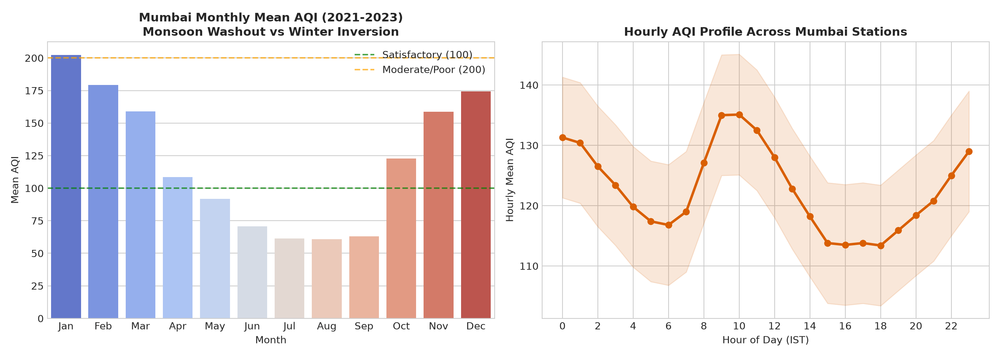
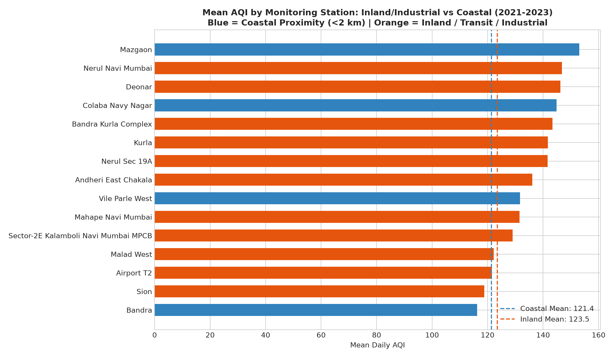
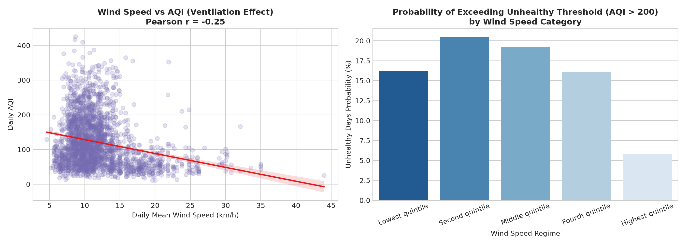
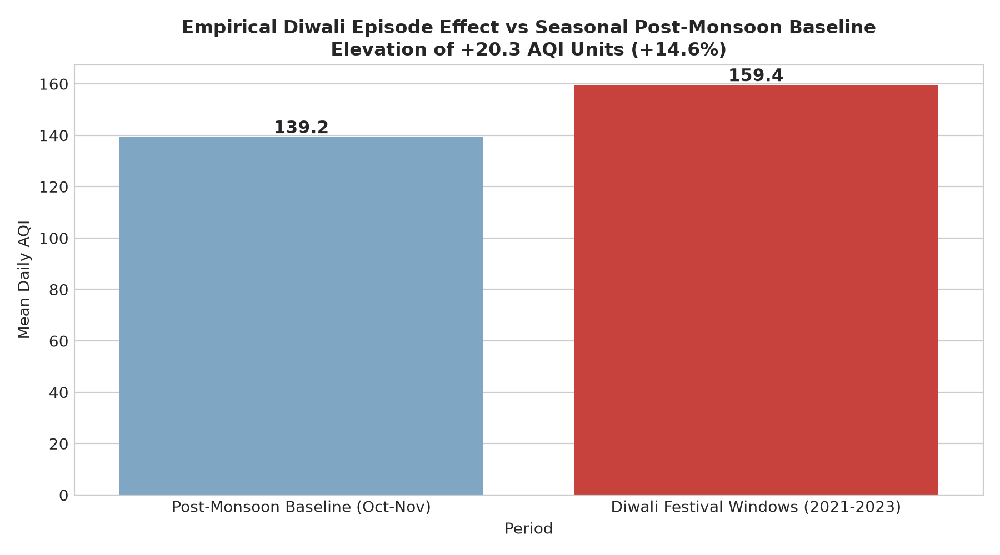
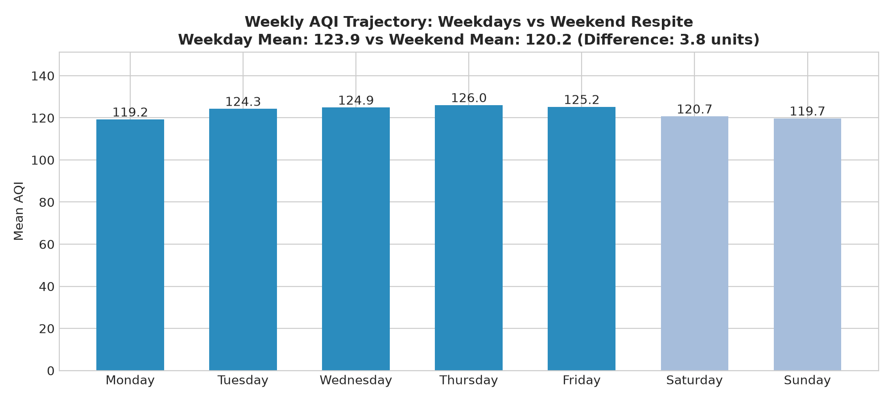

# Exploratory Data Analysis & Empirical Findings — CityPulse: Mumbai

Regulatory Decision-Support Synthesis for Municipal Officers (BMC / MPCB)  
Data Basis: 22,608 valid daily station observations across 36 station labels + 26,280 hourly weather observations (Latest Dataset).  
Attribution: Central Pollution Control Board (CPCB), Open-Meteo (CC BY 4.0), (C) OpenStreetMap contributors (ODbL).

---

## Finding 1: Seasonal Washout vs Winter Trapping & Diurnal Traffic Inversion

### 1. What We Observed
- **Extreme Seasonal Swing:** The summer monsoon (June–September) exhibits a dramatic air-cleansing "washout effect," yielding a citywide mean AQI of **63.9** (Good / Satisfactory). In sharp contrast, the winter period (December–February) surges to a mean AQI of **185.0**, representing an increase of **121.1 AQI units** (+189.6%).
- **Hourly Profile:** The highest mean hourly AQI occurs at **10:00 IST** (135.1); the lowest occurs at **18:00 IST** (113.4). The pattern alone does not identify its cause.

### 2. How Reliable Is It?
- **Coverage:** The seasonal comparison uses 22,608 station-days passing the project's 18-hour completeness threshold. Uneven station coverage can affect the pooled means.

### 3. Caveats & What Could Make It Wrong
- **Meteorological Confounding:** High winter AQI is not solely due to increased local emissions; it is heavily amplified by low planetary boundary layer (PBL) height and night-time thermal inversions that trap constant baseline emissions near the surface.
- **Sensor Moisture Artifacts:** High relative humidity during monsoon storms (> 90%) can occasionally induce optical hygroscopic growth in particle sensors if heating tubes fail, though regulatory gravimetric-calibrated beta-attenuation monitors mitigate this.

---

## Finding 2: Spatial Heterogeneity — Coastal Ventilation vs Inland Traffic / Industrial Hubs

### 1. What We Observed
- **Coastal and Inland Means:** Coastal station-days average **121.4 AQI** versus **123.5 AQI** inland. This small pooled difference does not establish a causal ventilation effect.
- **Station Variation:** Among stations with at least 150 valid days, **Mazgaon** has the highest mean (**153.0 AQI**) and **Borivali East** the lowest (**88.6 AQI**).

### 2. How Reliable Is It?
- **Comparison rule:** The extremes above exclude stations with fewer than 150 valid days, which otherwise dominate the high end of the ranking.

### 3. Caveats & What Could Make It Wrong
- **Micro-Scale Siting Bias:** Certain CAAQMS stations are positioned near ground-level intersections or elevated flyovers, reflecting micro-scale vehicular plumes rather than whole-ward ambient exposure.
- **Station Attrition:** Differential sensor uptime across stations (some offline during monsoon maintenance) can slightly skew the calculated unweighted annual averages.

---

## Finding 3: Meteorological Coupling — Sea-Breeze Ventilation & Stagnation

### 1. What We Observed
- **Wind Association:** Mean daily wind speed and AQI have Pearson correlation **$r = -0.25$**.
- **Grouped Risk:** The AQI > 200 rate is **16.2%** in the lowest wind-speed quintile and **5.8%** in the highest. These are sample quintiles, not fixed km/h cutoffs.
- **Temperature Association:** Temperature and AQI have correlation **$r = -0.28$**; season and location may confound both associations.

### 2. How Reliable Is It?
- Correlations are descriptive and do not show that changing wind speed would cause an equivalent change in AQI.

### 3. Caveats & What Could Make It Wrong
- **Reanalysis Resolution:** ERA5 surface weather represents a 0.25-degree grid, which smooths out micro-climatic sea-breeze fronts that penetrate inland Mumbai unevenly.

---

## Finding 4: Episodic Shocks — Diwali Firework Signal vs Baseline Meteorology

### 1. What We Observed
- **Observed Peak:** During the multi-day Diwali festival windows across the latest multi-year dataset, mean AQI climbed to **159.4**, compared to the post-monsoon seasonal baseline of **139.2**, reflecting a mean elevation of **+20.3 AQI units (+14.6%)**, with 90th percentile spikes reaching **235.6 AQI**.

### 2. How Reliable Is It?
- Replicated across all 3 monitoring years with sharp spikes during the exact festival dates.

### 3. Caveats & What Could Make It Wrong
- **Meteorological Coincidence:** Diwali occurs precisely during the post-monsoon seasonal wind reversal (transition from maritime south-westerly to continental north-easterly winds) and falling temperatures. A portion of the spike is atmospheric stagnation, not solely pyrotechnic biomass/chemical emissions.

---

## Finding 5: Weekly Anthropogenic Cycles — Weekday Commute vs Weekend Respite

### 1. What We Observed
- **Measurable Weekend Drop:** Weekdays (Monday–Friday) average **123.9 AQI**, while weekends (Saturday–Sunday) drop to **120.2 AQI**, a respite of **3.8 units**.

### 2. How Reliable Is It?
- The pooled mean difference is descriptive; no station-aware significance test is reported.

### 3. Caveats & What Could Make It Wrong
- Commercial activities, inter-city transport, and Sunday recreational traffic partially sustain weekend levels, muting the "Sunday drop" compared to strictly industrial cities.
